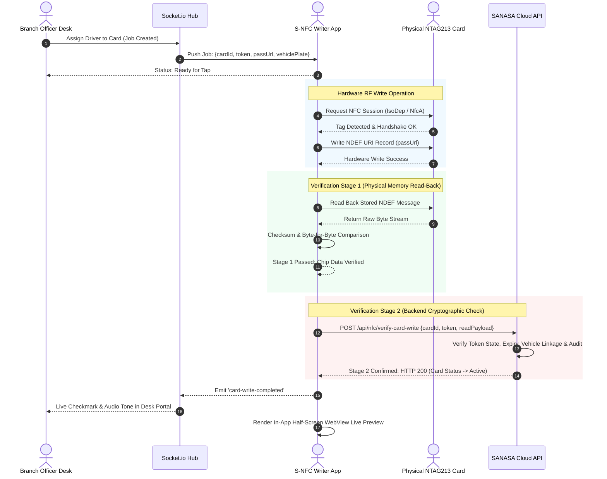

<div align="center">

# 💳 SANASA S-NFC Writer — Android Application
### Hardware Contactless NFC Card Provisioning & Verification Engine for SANASA Branch Staff

<br/>

<!-- Modern Call-To-Action Button Pills -->
<p align="center">
  <a href="https://expo.dev/artifacts/eas/9MZiZQmaqUOeg9vAiVoMKB-lYP_PA3yLlkIsk6k2anA.apk" target="_blank">
    
  </a>
  &nbsp;
  <a href="https://expo.dev/artifacts/eas/s4TXp2v686487RuygP7EmwNWwfV59IdjhFDWxos-REQ.apk" target="_blank">
    
  </a>
  &nbsp;
  <a href="https://sanasa-insurance-vehicle-damage-cla.vercel.app/" target="_blank">
    
  </a>
  &nbsp;
  <a href="https://github.com/gayathra45/SanasaInsuarance" target="_blank">
    
  </a>
</p>

<!-- Live Status & Standards Strip -->
<p align="center">
  
  &nbsp;
  
  &nbsp;
  
  &nbsp;
  
  &nbsp;
  
  &nbsp;
  
</p>

</div>

---

## 📌 Executive Overview

**SANASA S-NFC Writer** is a dedicated, production-grade Android application developed exclusively for authorized **SANASA General Insurance PLC** branch personnel. It provides the critical hardware integration bridge between the cloud-based **SClaim Go** insurance platform and physical, contactless smart cards issued to policyholders and authorized third-party drivers.

The application transforms any standard NFC-equipped Android smartphone into an industrial-grade **contactless encoding terminal**. It enables branch officers to wirelessly pair their mobile device with the desktop **SANASA Branch Claims Desk**, receive real-time driver provisioning requests over encrypted WebSockets, inspect physical smart card memory, write standardized NDEF URI records, execute rigorous two-stage hardware and cryptographic verification, and preview the live digital driver pass directly in an embedded half-screen WebView.

---

## 🔗 Ecosystem Synergy & System Architecture

The **S-NFC Writer** application operates as a specialized satellite client within the larger **SANASA General Insurance** digital infrastructure:

```mermaid
graph TB
    subgraph SANASA Cloud Core
        API["Node.js / Express REST Engine"]
        SOCKET["Socket.io Real-Time Dispatch Hub"]
        DB[("MongoDB Atlas Database")]
    end

    subgraph Branch Office Operations
        DESK["💻 Branch Officer Desk Web Portal<br/>(Next.js 16 App Router)"]
        NFC_PHONE["📱 SANASA S-NFC Writer App<br/>(Android Contactless Terminal)"]
        SMART_CARD["🪪 Physical Smart NFC Card<br/>(NXP NTAG213 / ISO 14443-A)"]
    end

    subgraph Roadside Operations
        DRIVER_PHONE["🚗 Third-Party Driver Phone<br/>(Zero-App Browser Tap)"]
        ASSESSOR["🛵 Field Insurance Assessor<br/>(SClaim Go Inspector)"]
    end

    DESK <-->|1. Fast Pairing (PIN / QR)| SOCKET
    NFC_PHONE <-->|2. Encrypted WebSocket Link| SOCKET
    DESK -->|3. Dispatch Card Write Job| SOCKET
    SOCKET -->|4. Push Encoding Payload| NFC_PHONE
    NFC_PHONE -->|5. Contactless RF NDEF Write| SMART_CARD
    NFC_PHONE -->|6. Stage 1 & 2 Verification| API
    API --> DB

    SMART_CARD -.->|Roadside Contactless Tap| DRIVER_PHONE
    DRIVER_PHONE -->|View Live Pass & File Scene Claim| API
    ASSESSOR -->|Inspect Digital Credentials| API
```

---

## 📱 Build & Download Details

| Parameter | Specification |
| :--- | :--- |
| **Application Name** | SANASA S-NFC Writer |
| **Package Name** | `com.sanasa.snfcwriter` |
| **Version** | `1.0.0` (Build `1`) |
| **SDK Framework** | React Native `0.88.1` / Expo SDK `58.0.22` |
| **Target OS** | Android 7.0+ (API Level 24 to 36) |
| **Direct APK Download Link** | **[Download S-NFC Writer APK](https://expo.dev/artifacts/eas/9MZiZQmaqUOeg9vAiVoMKB-lYP_PA3yLlkIsk6k2anA.apk)** |
| **EAS Cloud Build Verification** | [Build c616d569 on Expo Cloud](https://expo.dev/accounts/gayathra45/projects/s-nfc-writer/builds/c616d569-a872-4596-97c3-e2b18c873767) |
| **Dedicated GitHub Repository** | [https://github.com/gayathra45/SNFC-App](https://github.com/gayathra45/SNFC-App) |
| **Main Insurance System Repository**| [https://github.com/gayathra45/SanasaInsuarance](https://github.com/gayathra45/SanasaInsuarance) |

---

## 🪪 Hardware Specifications & Supported Silicon

The application utilizes high-performance low-level contactless protocols via `react-native-nfc-manager`:

| NFC Chipset Family | Manufacturer | User Memory | NDEF Compatibility | Primary Use Case in SANASA |
| :--- | :--- | :--- | :--- | :--- |
| **NXP NTAG213** | NXP Semiconductors | 144 Bytes | ✅ Full (Type 2 Tag) | **Standard Driver Smart Card** (Default Issued) |
| **NXP NTAG215** | NXP Semiconductors | 504 Bytes | ✅ Full (Type 2 Tag) | Extended Fleet Driver Cards |
| **NXP NTAG216** | NXP Semiconductors | 888 Bytes | ✅ Full (Type 2 Tag) | Multi-Vehicle High-Capacity Pass |
| **Mifare Ultralight EV1** | NXP Semiconductors | 48–128 Bytes | ✅ Type 2 Tag | Temporary Single-Day Delivery Driver Badges |
| **ISO 14443 Type A** | Universal Standards | Variable | ✅ Standard NDEF | Roadside Verification on any NFC Smartphone |

---

## 🛡️ Two-Stage Hardware & Cryptographic Verification Workflow

To guarantee zero encoding errors, prevent fraudulent duplicates, and ensure absolute roadside reliability, every card provisioning operation must pass a mandatory **Two-Stage Verification Pipeline**:



### Verification Safeguards:
1. **Stage 1 (Physical Integrity)**: The hardware re-reads the written memory blocks directly from the silicon chip to ensure zero RF corruption or detached-card write anomalies.
2. **Stage 2 (Cryptographic Integrity)**: The written token is sent back to the SANASA API to confirm that the driver record matches MongoDB state and that the pass URL resolves correctly.
3. **Half-Screen WebView Live Preview**: An embedded browser inside the app loads the live driver portal (`/driver-access/[token]`) so branch staff can visually confirm the driver's name, photograph, and vehicle number before physically handing the card to the customer.

---

## 🌟 Application Capabilities & Feature Breakdown

### 1. 🔗 Real-Time Desktop Desk Pairing
- **6-Digit One-Time PIN (OTP)**: Quickly pair the mobile phone with any branch desktop terminal by typing a 6-digit PIN displayed on the web dashboard.
- **QR Code Fast Scan**: Alternatively, scan the dynamic pairing QR code displayed on the desktop portal for instant biometric terminal lock.
- **WebSocket Reconnection & Heartbeats**: Background socket heartbeats with automatic reconnection handling intermittent branch Wi-Fi drops.

### 2. ⚡ Contactless RF Writing Console
- **Detailed Tag Inspection**: Instant display of Tag Type, Technologies (`NfcA`, `Ndef`), Memory Size, Writable Status, and Hardware UID.
- **Auto-Formatting**: Automatically formats virgin or unformatted NTAG tags into compliant NDEF storage containers.
- **Haptic Feedback**: High-precision vibration patterns on tag discovery, successful write, and verification failure via `expo-haptics`.

### 3. 👁️ Half-Screen Roadside Live Preview
- Embedded `react-native-webview` drawer that slides up upon successful encoding.
- Previews the exact experience the driver and roadside police/assessor will see when tapping the card.
- Displays vehicle registration number, driver identity, insurance cover note status, and emergency claims hotline.

### 4. 📜 Local Audit Trail & Offline Sync Queue
- Stores complete card write logs locally (Hardware UID, Card ID, Reference Number, Operator ID, and Timestamp).
- Automatic offline queue (`syncService`) caches verification telemetry if internet connectivity is temporarily disrupted, syncing as soon as network is restored.

---

## 💻 Dedicated Technology Stack

<div align="center">

### 1. Native Mobile Framework


### 2. Contactless Hardware & Native Modules


### 3. Cloud Networking & Build Architecture


</div>

---

## 📂 Project Structure & Modular Directory Layout

```
SANASA NFC Writer/
├── app/
│   ├── _layout.tsx                  # Root Stack Navigator & Theme Provider
│   ├── index.tsx                    # Splash Screen & Auth Router
│   ├── card-detail.tsx              # Deep-Inspection Card Modal
│   ├── settings.tsx                 # Dynamic Server IP & Diagnostics
│   ├── (auth)/
│   │   └── login.tsx                # Branch Staff Identity Login
│   └── (tabs)/
│       ├── _layout.tsx              # Modern Bottom Tab Navigator
│       ├── index.tsx                # Dashboard, Metrics & Transfer Banner
│       ├── pairing.tsx              # Desktop Portal Pairing Console (PIN / QR)
│       ├── writer.tsx               # Contactless NFC Writer & Verification Engine
│       └── history.tsx              # Provisioning Audit Log & History
│
├── assets/                          # Verified PNG App Icons, Adaptive Badges & Logos
│   ├── icon.png                     # Standard 1024x1024 App Icon (Valid PNG)
│   ├── adaptive-icon.png            # Android 13+ Foreground Vector Icon
│   ├── logo.png                     # Official SANASA Corporate Emblem
│   └── splash.png                   # Brand Splash Launch Screen
│
├── src/
│   ├── config/
│   │   └── api.ts                   # Centralized Endpoints & Automatic IP Discovery
│   └── services/
│       ├── authService.ts           # Staff JWT Authentication & Session Token
│       ├── nfcService.ts            # Native Hardware Detection & NDEF Write Protocol
│       ├── pairingService.ts        # 6-Digit PIN Pairing Logic
│       ├── socketService.ts         # Real-Time WebSocket Client & Event Dispatcher
│       ├── storageService.ts        # Encrypted Credentials & Local Audit Store
│       └── syncService.ts           # Verification Sync & Offline Queue Manager
│
├── app.json                         # Expo Config, NFC Hardware Permissions & Plugins
├── eas.json                         # EAS Cloud Build Configuration (APK Profile)
├── package.json                     # NPM Dependencies & Scripts
├── tsconfig.json                    # Strict TypeScript Compiler Configuration
└── README.md                        # Application Documentation
```

---

## 🛠️ Local Development & Build Instructions

### Prerequisites
- **Node.js**: v20 or v22
- **Java**: JDK 21+ (Tested on JDK 26)
- **Android SDK**: Android API 36 / 37 Build-Tools installed (if building locally)
- **Hardware**: Android smartphone with physical NFC capability (NFC enabled in System Settings)

### 1. Installation & Local Development
```bash
# 1. Clone the dedicated repository
git clone https://github.com/gayathra45/SNFC-App.git
cd SNFC-App

# 2. Install dependencies
npm install

# 3. Start development server
npx expo start -c
```

### 2. Direct Deployment to Physical Phone via USB Debugging
Connect your Android phone via USB with **Developer Options & USB Debugging** enabled:
```bash
npx expo run:android
```

### 3. Generate Standalone APK Locally (Offline via Gradle)
```bash
# Prebuild the native Android project
npx expo prebuild --platform android

# Compile Debug APK
cd android
.\gradlew.bat assembleDebug

# Output APK path:
# android/app/build/outputs/apk/debug/app-debug.apk
```

### 4. Cloud Build via EAS (Expo Application Services)
```bash
# Log in to Expo account
npx eas-cli login

# Trigger cloud APK compilation
npx eas-cli build -p android --profile preview
```

---

## 🔒 Security, Compliance & Governance

- **Zero Plaintext Token Exposure**: Pass URLs are masked in the UI; verification operates strictly through salted backend signatures.
- **Hardware Write-Protection Option**: The app supports sending permanent lock bytes to NTAG213 chips, making the card read-only to prevent unauthorized tampering on the roadside.
- **Role-Based Access Control (RBAC)**: Only verified branch officers with active staff credentials can authenticate and pair devices.
- **Immutable Audit Trail**: Every card write records the timestamp, terminal ID, staff user ID, vehicle registration plate, and physical silicon UID for non-repudiation.

---

## 📄 License & Ownership

- **Software License**: Licensed under the **[MIT License](./LICENSE)**.
- **Client Organization**: SANASA General Insurance PLC (Sri Lanka).
- **Engineering Lead & Author**: Gayathra Samuditha ([@gayathra45](https://github.com/gayathra45))
- **Dedicated Application Repository**: [https://github.com/gayathra45/SNFC-App](https://github.com/gayathra45/SNFC-App)
- **Main SClaim Go Insurance Platform**: [https://github.com/gayathra45/SanasaInsuarance](https://github.com/gayathra45/SanasaInsuarance)
